<!-- Generated by tools/build_people.py from people/people.json. Do not edit by hand. -->

<a href="https://github.com/ZJU-OmniAI"><picture><source media="(prefers-color-scheme: dark)" srcset="../profile/assets/links/home-dark.svg"></picture></a>&nbsp;
<a href="https://github.com/ZJU-OmniAI#news"><picture><source media="(prefers-color-scheme: dark)" srcset="../profile/assets/links/news-dark.svg"></picture></a>&nbsp;
<a href="https://github.com/orgs/ZJU-OmniAI/repositories"><picture><source media="(prefers-color-scheme: dark)" srcset="../profile/assets/links/repos-dark.svg"></picture></a>&nbsp;
<a href="https://huggingface.co/OmniAI-ZJU"><picture><source media="(prefers-color-scheme: dark)" srcset="../profile/assets/links/huggingface-dark.svg"></picture></a>

<picture><source media="(prefers-color-scheme: dark)" srcset="assets/hero-dark.svg"></picture>

成员按姓氏排序，照片与信息陆续更新中 · Listed by family name; photos and details coming soon.

<picture><source media="(prefers-color-scheme: dark)" srcset="assets/section-faculty-dark.svg"></picture>

<table>
<tr>
<td valign="top" width="50%">
<picture><source media="(prefers-color-scheme: dark)" srcset="assets/faces/xuhong-zhang-dark.svg"></picture>
<b>Xuhong Zhang · 张旭鸿</b> 
Faculty · Zhejiang University 
&nbsp;&nbsp;
 
</td>
<td valign="top" width="50%">
<picture><source media="(prefers-color-scheme: dark)" srcset="assets/faces/wenqi-zhang-dark.svg"></picture>
<b><a href="https://zwq2018.github.io/">Wenqi Zhang</a> · 张文祺</b> 
Faculty · Zhejiang University 
zhangwenqi [AT] zju.edu.cn 
&nbsp;&nbsp;&nbsp;&nbsp;&nbsp;&nbsp;
 
</td>
</tr>
</table>

<picture><source media="(prefers-color-scheme: dark)" srcset="assets/section-phd-students-dark.svg"></picture>

<a href="https://github.com/chensunlai" title="Sunlai Chen"><picture><source media="(prefers-color-scheme: dark)" srcset="assets/cards/sunlai-chen-dark.svg"></picture></a>
<picture><source media="(prefers-color-scheme: dark)" srcset="assets/cards/qinfeng-li-dark.svg"></picture>
<a href="https://pm1255.github.io/" title="Miao Pan (潘淼)"><picture><source media="(prefers-color-scheme: dark)" srcset="assets/cards/miao-pan-dark.svg"></picture></a>
<picture><source media="(prefers-color-scheme: dark)" srcset="assets/cards/kaixiang-yao-dark.svg"></picture>

<picture><source media="(prefers-color-scheme: dark)" srcset="assets/section-master-s-students-dark.svg"></picture>

<picture><source media="(prefers-color-scheme: dark)" srcset="assets/cards/hongze-chen-dark.svg"></picture>
<a href="https://github.com/fhylove" title="Hongyan Feng"><picture><source media="(prefers-color-scheme: dark)" srcset="assets/cards/hongyan-feng-dark.svg"></picture></a>
<picture><source media="(prefers-color-scheme: dark)" srcset="assets/cards/sicheng-he-dark.svg"></picture>
<picture><source media="(prefers-color-scheme: dark)" srcset="assets/cards/jiaming-huang-dark.svg"></picture>
<a href="https://github.com/llz1515" title="Lizhou Liang"><picture><source media="(prefers-color-scheme: dark)" srcset="assets/cards/lizhou-liang-dark.svg"></picture></a>
<picture><source media="(prefers-color-scheme: dark)" srcset="assets/cards/xuanyu-liu-dark.svg"></picture>
<a href="https://github.com/Baixiaochi9449" title="Qi Lu"><picture><source media="(prefers-color-scheme: dark)" srcset="assets/cards/qi-lu-dark.svg"></picture></a>
<a href="https://github.com/YiPan-ECLab" title="Yi Pan"><picture><source media="(prefers-color-scheme: dark)" srcset="assets/cards/yi-pan-dark.svg"></picture></a>
<a href="https://xuwang917.github.io/" title="Xu Wang (王旭)"><picture><source media="(prefers-color-scheme: dark)" srcset="assets/cards/xu-wang-dark.svg"></picture></a>
<a href="https://github.com/DawnChase" title="Xiaohe Zhou"><picture><source media="(prefers-color-scheme: dark)" srcset="assets/cards/xiaohe-zhou-dark.svg"></picture></a>

<picture><source media="(prefers-color-scheme: dark)" srcset="../profile/assets/divider-dark.svg"></picture>

 
<a href="https://github.com/ZJU-OmniAI"><picture><source media="(prefers-color-scheme: dark)" srcset="../profile/assets/links/home-dark.svg"></picture></a>&nbsp;
<a href="https://github.com/ZJU-OmniAI#news"><picture><source media="(prefers-color-scheme: dark)" srcset="../profile/assets/links/news-dark.svg"></picture></a>&nbsp;
<a href="https://github.com/orgs/ZJU-OmniAI/repositories"><picture><source media="(prefers-color-scheme: dark)" srcset="../profile/assets/links/repos-dark.svg"></picture></a>&nbsp;
<a href="https://huggingface.co/OmniAI-ZJU"><picture><source media="(prefers-color-scheme: dark)" srcset="../profile/assets/links/huggingface-dark.svg"></picture></a>&nbsp;
<a href="mailto:zhangwenqi@zju.edu.cn"><picture><source media="(prefers-color-scheme: dark)" srcset="../profile/assets/links/contact-dark.svg"></picture></a>

