<!-- Generated by tools/build_people.py from people/people.json. Do not edit by hand. -->

<picture><source media="(prefers-color-scheme: dark)" srcset="../profile/assets/people-banner-dark.svg"></picture>

<a href="https://github.com/ZJU-OmniAI"><picture><source media="(prefers-color-scheme: dark)" srcset="../profile/assets/links/home-dark.svg"></picture></a>

**ZJU-OmniAI** at Zhejiang University builds AI **from the digital world to the physical world**: systems that perceive, reason, act, and remember. Members are listed by family name with their representative projects.

浙江大学 OmniAI 团队，从数字世界到物理世界，研究感知、推理、行动、记忆的智能闭环。成员按姓氏字母排序，并列出代表项目。

照片与成员信息陆续更新中 · Photos and member details are being updated.

### Faculty · 指导教师

<table>
<tr><td align="center" valign="top" width="50%"> <h3>Xuhong Zhang · 张旭鸿</h3>Zhejiang University </td><td align="center" valign="top" width="50%"> <h3><a href="https://zwq2018.github.io/">Wenqi Zhang</a> · 张文祺</h3>Zhejiang University &nbsp;&nbsp;&nbsp;&nbsp;&nbsp;&nbsp;</td></tr>
</table>

### Members · 团队成员

<table>
<tr><td align="center" valign="top" width="25%"> <b>Hongze Chen</b> DTCA </td><td align="center" valign="top" width="25%"> <b>Sunlai Chen</b> Embodied-Navigator · Scene-Designer </td><td align="center" valign="top" width="25%"> <b>Hongyan Feng</b> Embodied-Navigator </td><td align="center" valign="top" width="25%"> <b>Sicheng He</b> VLA-Rolling </td></tr>
<tr><td align="center" valign="top" width="25%"> <b>Jiaming Huang</b> VLA-Rolling · VLA-Corrector </td><td align="center" valign="top" width="25%"> <b>Qinfeng Li</b> EmbodiedMemory-Bench · DTCA </td><td align="center" valign="top" width="25%"> <b>Lizhou Liang</b> EmbodiedMemory-Bench </td><td align="center" valign="top" width="25%"> <b>Xuanyu Liu</b> Scene-Designer </td></tr>
<tr><td align="center" valign="top" width="25%"> <b>Qi Lu</b> VLA-Δ </td><td align="center" valign="top" width="25%"> <b>Miao Pan</b> VLA-Corrector · VeriRL </td><td align="center" valign="top" width="25%"> <b>Yi Pan</b> VLA-Corrector </td><td align="center" valign="top" width="25%"> <b>Fu Teng</b> VeriRL </td></tr>
<tr><td align="center" valign="top" width="25%"> <b><a href="https://xuwang917.github.io/">Xu Wang</a></b> ProVisE &nbsp;&nbsp;</td><td align="center" valign="top" width="25%"> <b>Kaixiang Yao</b> Spatial-Interactor </td><td align="center" valign="top" width="25%"> <b>Xiaohe Zhou</b> EmbodiedMemory-Bench · ProVisE </td><td align="center" valign="top" width="25%"> <b>Yingxuan Zhuang</b> MGAP </td></tr>
</table>

<picture><source media="(prefers-color-scheme: dark)" srcset="../profile/assets/divider-dark.svg"></picture>

 
<a href="https://github.com/ZJU-OmniAI"><picture><source media="(prefers-color-scheme: dark)" srcset="../profile/assets/links/home-dark.svg"></picture></a>&nbsp;
<a href="https://github.com/orgs/ZJU-OmniAI/repositories"><picture><source media="(prefers-color-scheme: dark)" srcset="../profile/assets/links/repos-dark.svg"></picture></a>&nbsp;
<a href="https://huggingface.co/OmniAI-ZJU"><picture><source media="(prefers-color-scheme: dark)" srcset="../profile/assets/links/huggingface-dark.svg"></picture></a>&nbsp;
<a href="mailto:zhangwenqi@zju.edu.cn"><picture><source media="(prefers-color-scheme: dark)" srcset="../profile/assets/links/contact-dark.svg"></picture></a>

