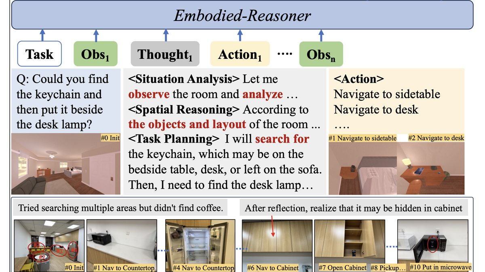
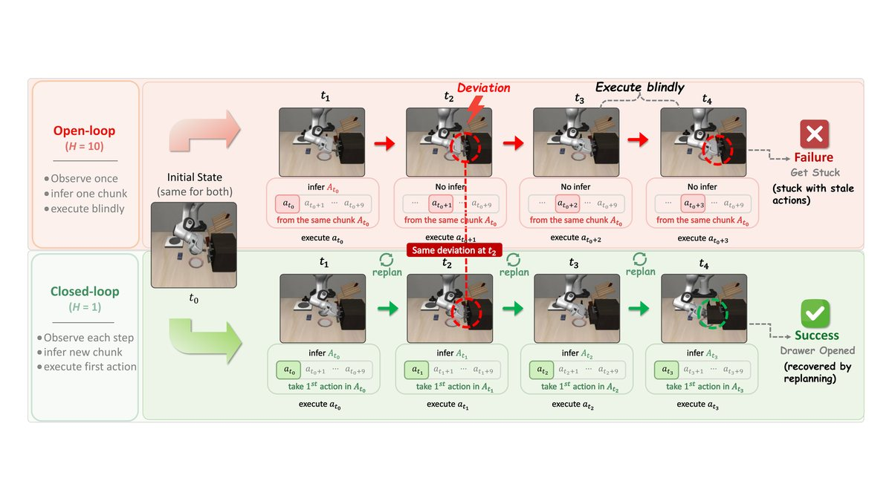
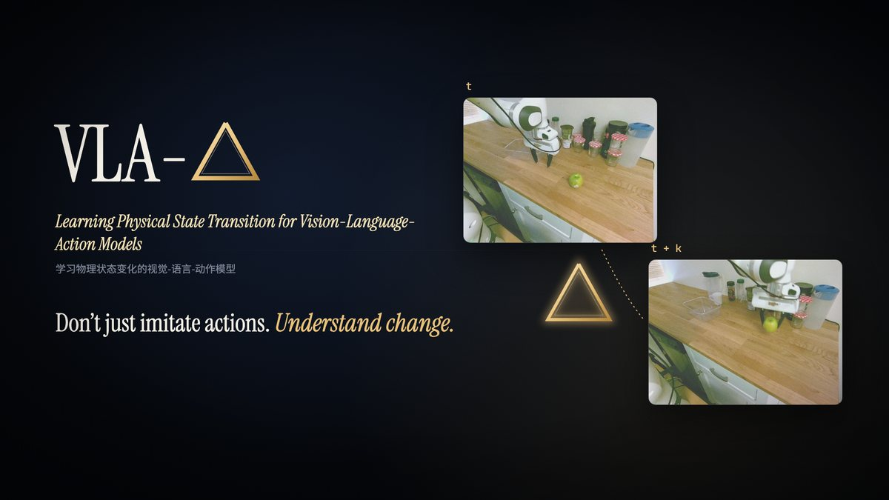
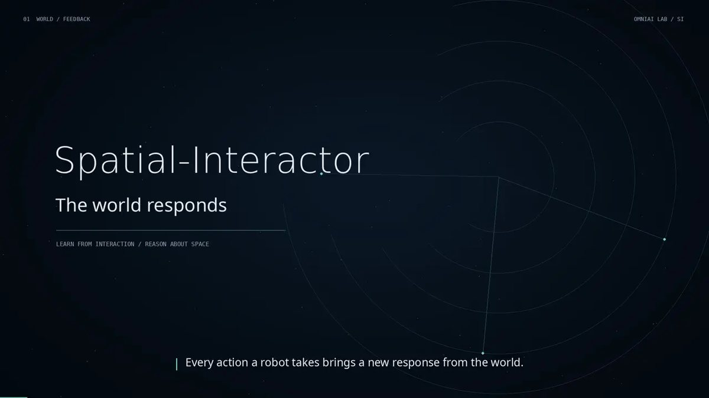
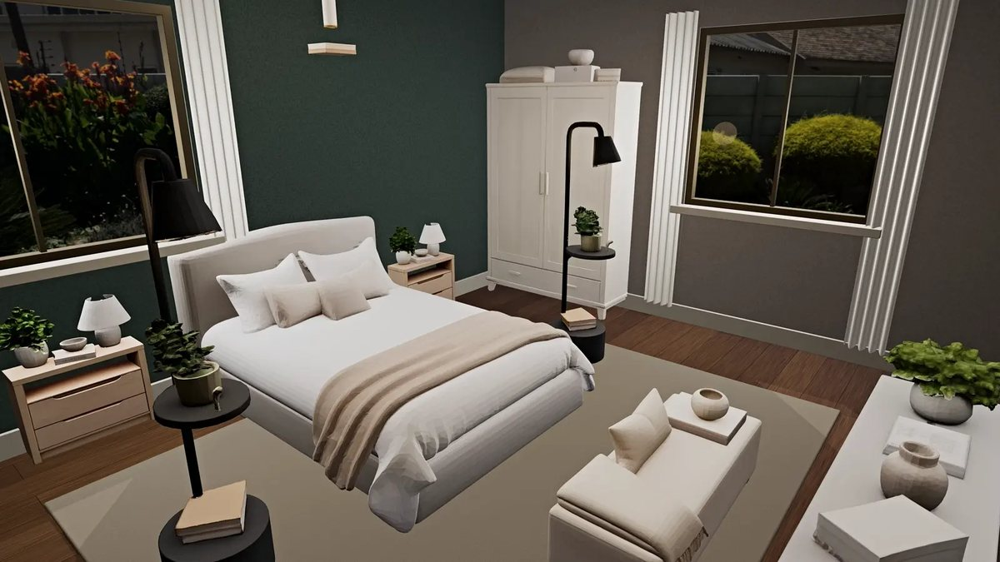
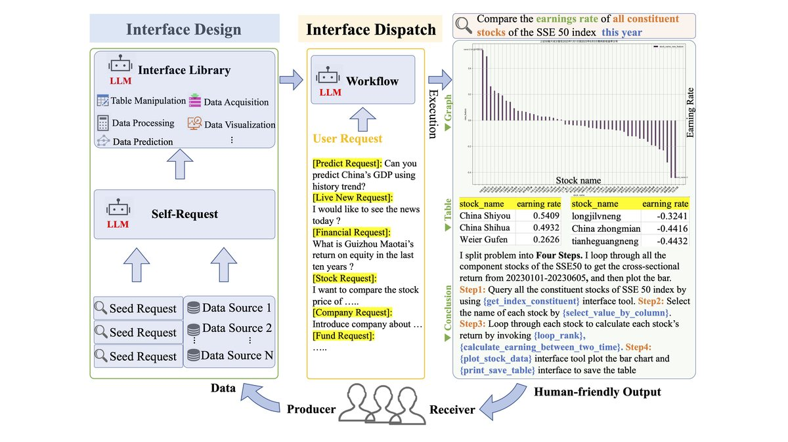

<picture>
  <source media="(prefers-color-scheme: dark)" srcset="assets/banner-dark.svg">
  
</picture>

  
  
  
  
   
  
  &nbsp;
  
  &nbsp;
  

**浙江大学 OmniAI 团队**，关注从感知、推理、记忆到行动的智能闭环，以**具身小脑与具身大脑**为主线，探索通用智能的学习与实践

<picture>
  <source media="(prefers-color-scheme: dark)" srcset="assets/divider-dark.svg">
  
</picture>

**ZJU-OmniAI** at Zhejiang University builds AI systems that connect multimodal understanding with reasoning and action. Our research spans **embodied intelligence**, **spatial cognition**, **trustworthy multimodal models**, **reinforcement learning**, and **autonomous agents**.

  <a href="#news"><b>News</b></a> ·
  <a href="#featured"><b>Featured Projects</b></a> ·
  <a href="#research"><b>Research Map</b></a> ·
  <a href="#tools"><b>Tools</b></a> ·
  <a href="https://github.com/orgs/ZJU-OmniAI/repositories"><b>All Repositories</b></a>

## News · 最新动态

- **2026.11** &nbsp;`MEDIA`&nbsp; 量子位 reports [**VLA-Δ**](https://github.com/ZJU-OmniAI/VLA-Delta): [《2B模型拿下98.4%成功率！浙大VLA新成果让机器人学会状态变化》](https://mp.weixin.qq.com/s?__biz=MzIzNjc1NzUzMw==&mid=2247944089&idx=3&sn=921607acca3d33beb525df750c81272b&chksm=e9251f0e49a96bc5bc031302fd92ceb5984e597eb46cebeb469be0107602844b039915dec49e#rd) · [项目主页](https://zju-omniai.github.io/VLA-Delta/)
- **2026.10** &nbsp;`PAPER`&nbsp; [**DTCA**](https://github.com/ZJU-OmniAI/DTCA): token-level credit assignment for reinforcement learning in diffusion language models, learning which denoising tokens deserve credit. [Paper](https://arxiv.org/abs/2610.35201) · [Project](https://zju-omniai.github.io/DTCA/)
- **2026.10** &nbsp;`PAPER`&nbsp; [**Scene-Designer**](https://github.com/ZJU-OmniAI/Scene-Designer): agentic 3D scene generation that learns to both design and critique scenes, from **Scene-OTA-35K** and **Scene-OTC-15K** with Critic-guided Scene-GRPO. [Paper](https://arxiv.org/abs/2610.23121) · [Project](https://zju-omniai.github.io/Scene-Designer/)
- **2026.10** &nbsp;`PAPER`&nbsp; [**VLA-Rolling**](https://github.com/ZJU-OmniAI/VLA-Rolling): carries the unexecuted action tail into the next planning window, with a lightweight confidence estimator setting the denoising budget while the base VLA stays frozen. [Paper](https://arxiv.org/abs/2610.25043) · [Project](https://chenbao123ww.github.io/VLA-Rolling/)
- **2026.10** &nbsp;`PAPER`&nbsp; [**VLA-Δ**](https://github.com/ZJU-OmniAI/VLA-Delta): learns physical state transitions for robot control, reaching **98.4%** on LIBERO, **90.06%** on RoboTwin 2.0 (Clean), and **68.0%** across five real-robot tasks. [Paper](https://arxiv.org/abs/2610.21306) · [Project](https://zju-omniai.github.io/VLA-Delta/)
- **2026.10** &nbsp;`MEDIA`&nbsp; 新智元 reports [**EmbodiedMemory-Bench**](https://github.com/ZJU-OmniAI/Embodied-Omni/tree/main/embodied_memory): [《具身智能体长程记忆：看见不等于记住，浙大提出具身记忆基准》](https://mp.weixin.qq.com/s?__biz=MzI3MTA0MTk1MA==&mid=2652735627&idx=3&sn=2195898b4588173b111e6ffc13732156) · [项目主页](https://zju-omniai.github.io/Embodied-Omni/EmbodiedMemoryBench/)
- **2026.10** &nbsp;`MEDIA`&nbsp; 青稞 AI reports [**Spatial-Interactor**](https://github.com/ZJU-OmniAI/Spatial-Interactor): [《让大模型从运动和交互中学习空间推理，理解环境变化。浙大团队最新提出Spatial-Interactor》](https://www.qingkeai.online/blog/Spatial-Interactor) · [项目主页](https://zju-omniai.github.io/Spatial-Interactor/)

<b>Earlier news</b>

 

- **2026.09** &nbsp;`NeurIPS 2026`&nbsp; [**VLA-Corrector**](https://github.com/ZJU-OmniAI/vla-corrector) is accepted to NeurIPS 2026. 机器之心 coverage: [《VLA开环盲区，终于被堵上了：40M Corrector让机器人边做边纠错》](https://mp.weixin.qq.com/s/rfSPbtc2_fRpggXeBPPC3Q) · [项目主页](https://zju-omniai.github.io/vla-corrector/)
- **2026.09** &nbsp;`PAPER`&nbsp; [**EmbodiedMemory-Bench**](https://github.com/ZJU-OmniAI/Embodied-Omni/tree/main/embodied_memory): a benchmark for memory in long-horizon embodied tasks, with **2,554 executable episodes**. [Paper](https://arxiv.org/abs/2609.28236) · [Project](https://zju-omniai.github.io/Embodied-Omni/EmbodiedMemoryBench/)
- **2026.09** &nbsp;`PAPER`&nbsp; [**Spatial-Interactor**](https://github.com/ZJU-OmniAI/Spatial-Interactor): learns local state transitions and long-horizon spatial reasoning from real and simulated interaction trajectories. [Paper](https://arxiv.org/abs/2609.23038) · [Project](https://zju-omniai.github.io/Spatial-Interactor/)
- **2026.08** &nbsp;`PAPER`&nbsp; [**Embodied-Navigator**](https://github.com/ZJU-OmniAI/Embodied-Omni/tree/main/embodied_navigator) joins the Embodied-Omni series. 新智英 coverage: [《浙大&浙江人形提出高效具身导航模型，统一动作、思考、记忆与强化学习！》](https://mp.weixin.qq.com/s?__biz=MzE5MTA0NzYxMQ==&mid=2247517546&idx=1&sn=36f6f48ef7b205cf90921a6a0326cc68&chksm=97edfe09f63dfb5ccf46fd2d1e053538b6eadff657e2bc32af7dc1723ccae29ccc05cb0620eb#rd) · [项目主页](https://zju-omniai.github.io/Embodied-Navigator/)
- **2026.08** &nbsp;`MEDIA`&nbsp; 机器之心 reports [**ProVisE**](https://github.com/ZJU-OmniAI/ProVisE): [《让生成式模型「画」出空间智能，而非强迫LLM输出「坐标」! 浙大提出Agentic空间认知评估框架》](https://www.jiqizhixin.com/articles/2026-08-08-4) · [微信原文](https://mp.weixin.qq.com/s?__biz=MzA3MzI4MjgzMw==&mid=2651049201&idx=3&sn=0d392ccc606293b0469161d091a1d940&chksm=85dcf83ea1bfefa7e91ac9e0132a73729751589a0ef4bfc3e6078a510bda7c0ed3b55d79a251#rd) · [项目主页](https://zju-omniai.github.io/ProVisE/)
- **2026.07** &nbsp;`MEDIA`&nbsp; 具身智能之心 reports [**VLA-Corrector**](https://github.com/ZJU-OmniAI/vla-corrector): [《40M 补上开环盲区！VLA-Corrector 让 VLA 学会发现并纠错（浙大&达摩院）》](https://mp.weixin.qq.com/s?__biz=MzkyMDY0OTc1NA==&mid=2247540637&idx=1&sn=0f177736092e21a930e0d9dc40a2a583). The paper is featured in [Hugging Face Daily Papers](https://huggingface.co/papers/2607.01804).
- **2026.04** &nbsp;`ACL 2026`&nbsp; [**Embodied-Reasoner**](https://github.com/ZJU-OmniAI/Embodied-Omni/tree/main/embodied_reasoner) is accepted to the ACL 2026 Main Conference, and [**GFT**](https://github.com/ZJU-OmniAI/GFT) to ACL 2026 Findings.
- **2025.11** &nbsp;`AAAI 2026`&nbsp; [**OMNEX-VL**](https://github.com/ZJU-OmniAI/OMNEX-VL) is accepted to AAAI 2026.

## Featured Projects · 代表项目

<table>
<tr>
<td width="50%" valign="top">

<b><a href="https://github.com/ZJU-OmniAI/Embodied-Omni">Embodied-Omni</a></b> &nbsp;<code>ACL 2026 Main</code> 
  
Our embodied-brain series in one repository: <b>Embodied-Reasoner</b> plans and reflects, <b>Embodied-Navigator</b> points, thinks, and remembers on the move, and <b>EmbodiedMemory-Bench</b> tests long-horizon memory. 
<a href="https://embodied-reasoner.github.io/">Reasoner</a> · <a href="https://zju-omniai.github.io/Embodied-Navigator/">Navigator</a> · <a href="https://zju-omniai.github.io/Embodied-Omni/EmbodiedMemoryBench/">Memory-Bench</a>
</td>
<td width="50%" valign="top">

<b><a href="https://github.com/ZJU-OmniAI/vla-corrector">VLA-Corrector</a></b> &nbsp;<code>NeurIPS 2026</code> 
 
A lightweight external corrector that watches for visual drift during action chunks, interrupts stale actions, and triggers replanning, so open-loop VLA policies recover instead of failing blindly. 
<a href="https://arxiv.org/abs/2607.01804">Paper</a> · <a href="https://zju-omniai.github.io/vla-corrector/">Project</a>
</td>
</tr>
<tr>
<td width="50%" valign="top">

<b><a href="https://github.com/ZJU-OmniAI/VLA-Delta">VLA-Δ</a></b> &nbsp;<code>arXiv 2026</code> 
  
Don't just imitate actions, understand change: learns physical state transitions for robot control, with 98.4% on LIBERO and 68.0% across five real-robot tasks. 
<a href="https://arxiv.org/abs/2610.21306">Paper</a> · <a href="https://zju-omniai.github.io/VLA-Delta/">Project</a> · <a href="https://huggingface.co/models?search=t0rn0d0/VLA-Delta">🤗 Models</a>
</td>
<td width="50%" valign="top">

<b><a href="https://github.com/ZJU-OmniAI/Spatial-Interactor">Spatial-Interactor</a></b> &nbsp;<code>arXiv 2026</code> 
  
The world responds: learns spatial reasoning from motion and interaction, covering local state transitions and long-horizon reasoning in real and simulated trajectories. 
<a href="https://arxiv.org/abs/2609.23038">Paper</a> · <a href="https://zju-omniai.github.io/Spatial-Interactor/">Project</a> · <a href="https://huggingface.co/datasets/kagakouko/LSI-108K">🤗 LSI-108K</a>
</td>
</tr>
<tr>
<td width="50%" valign="top">

<b><a href="https://github.com/ZJU-OmniAI/Scene-Designer">Scene-Designer</a></b> &nbsp;<code>arXiv 2026</code> 
  
Design intelligence for agentic 3D scene generation: build physically valid, functionally correct scenes, critique them, and refine with Critic-guided Scene-GRPO. 
<a href="https://arxiv.org/abs/2610.23121">Paper</a> · <a href="https://zju-omniai.github.io/Scene-Designer/">Project</a> · <a href="https://huggingface.co/XuanyuLiu/Scene-Builder-Qwen3-VL-8B-Instruct">🤗 Model</a>
</td>
<td width="50%" valign="top">

<b><a href="https://github.com/ZJU-OmniAI/Data-Copilot">Data-Copilot</a></b> &nbsp;<code>ICLR 2024 Workshop · Oral</code> 
 
Connects natural-language requests with heterogeneous data: the agent designs its own interface tools, then plans analysis and visualization workflows on demand. 
<a href="https://arxiv.org/abs/2306.07209">Paper</a> · <a href="https://openreview.net/forum?id=iUEBnQyfWE">OpenReview</a>
</td>
</tr>
</table>

## Research Map · 研究方向

<picture>
  <source media="(prefers-color-scheme: dark)" srcset="assets/research-map-dark.svg">
  
</picture>

### 01 · 具身小脑 · Embodied Cerebellum

Action learning, efficient execution, and closed-loop correction. 让机器人理解动作带来的物理变化，在执行中感知偏差、及时纠错。

| Project | Focus | Links |
| :-- | :-- | :-- |
| **[VLA-Corrector](https://github.com/ZJU-OmniAI/vla-corrector)** NeurIPS 2026 | Monitor visual drift during action chunks, interrupt stale actions, and guide corrective replanning with a lightweight external corrector. | [Paper](https://arxiv.org/abs/2607.01804) · [Project](https://zju-omniai.github.io/vla-corrector/) |
| **[VLA-Δ](https://github.com/ZJU-OmniAI/VLA-Delta)** arXiv 2026 | Learn action-relevant representations from physical state differences, then generate continuous actions with a flow-matching action expert. | [Paper](https://arxiv.org/abs/2610.21306) · [Project](https://zju-omniai.github.io/VLA-Delta/) · [🤗 Models](https://huggingface.co/models?search=t0rn0d0/VLA-Delta) |
| **[VLA-Rolling](https://github.com/ZJU-OmniAI/VLA-Rolling)** arXiv 2026 | Carry the unexecuted action tail into the next planning window; a confidence estimator sets renoising and the denoising budget. | [Paper](https://arxiv.org/abs/2610.25043) · [Project](https://chenbao123ww.github.io/VLA-Rolling/) · [🤗 Model](https://huggingface.co/Chenbao77/VLA-Rolling) |

📚 Reading list: **[Awesome Closed-Loop VLA](https://github.com/ZJU-OmniAI/Awesome-Closed-Loop-VLA)**, connecting execution, prediction, and learning loops.

### 02 · 具身大脑 · Embodied Brain

Reasoning, planning, navigation, and memory for long-horizon interaction. 让智能体理解环境、记住经验、规划任务，并在交互中反思与调整。All three projects live in the **[Embodied-Omni](https://github.com/ZJU-OmniAI/Embodied-Omni)** repository.

| Project | Focus | Links |
| :-- | :-- | :-- |
| **[Embodied-Reasoner](https://github.com/ZJU-OmniAI/Embodied-Omni/tree/main/embodied_reasoner)** ACL 2026 Main | Combine visual search, long-horizon planning, environment-state reasoning, and reflection in an observation–thought–action loop. | [Paper](https://aclanthology.org/2026.acl-long.1910/) · [Project](https://embodied-reasoner.github.io/) · [🤗 Data](https://huggingface.co/datasets/zwq2018/embodied_reasoner) |
| **[Embodied-Navigator](https://github.com/ZJU-OmniAI/Embodied-Omni/tree/main/embodied_navigator)** arXiv 2026 | Connect pixel pointing to 3D navigation with selective reasoning, Anchor-Trajectory Memory, and Two-Level GRPO. | [Paper](https://arxiv.org/abs/2608.17512) · [Project](https://zju-omniai.github.io/Embodied-Navigator/) · [🤗 Model](https://huggingface.co/UnderTides/Embodied-Navigator-7B-GRPO) |
| **[EmbodiedMemory-Bench](https://github.com/ZJU-OmniAI/Embodied-Omni/tree/main/embodied_memory)** arXiv 2026 | Evaluate retained observations, changing world states, interaction-derived knowledge, and experience generalization. | [Paper](https://arxiv.org/abs/2609.28236) · [Project](https://zju-omniai.github.io/Embodied-Omni/EmbodiedMemoryBench/) · [🤗 Data](https://huggingface.co/datasets/lzLiang/EmbodiedMemoryBench) |

### 03 · 空间智能与世界模型 · Spatial Intelligence & World Models

Learning and evaluating how AI understands and constructs the physical world. 从交互中学习空间关系与状态变化，建立可检验的空间认知，并让智能体设计物理合理、功能正确的 3D 场景。

| Project | Focus | Links |
| :-- | :-- | :-- |
| **[Spatial-Interactor](https://github.com/ZJU-OmniAI/Spatial-Interactor)** arXiv 2026 | Learn local state transitions and long-horizon spatial reasoning from real and simulated interaction trajectories. | [Paper](https://arxiv.org/abs/2609.23038) · [Project](https://zju-omniai.github.io/Spatial-Interactor/) · [🤗 Models](https://huggingface.co/models?search=kagakouko/Spatial-Interactor) · [🤗 Data](https://huggingface.co/datasets/kagakouko/LSI-108K) |
| **[ProVisE](https://github.com/ZJU-OmniAI/ProVisE)** arXiv 2026 | Evaluate spatial cognition through protocol-constrained visual answers, sharing task semantics and metrics across model families. | [Paper](https://arxiv.org/abs/2607.21072) · [Project](https://zju-omniai.github.io/ProVisE/) · [🤗 Data](https://huggingface.co/datasets/wx91726/SpatialGen-Bench) |
| **[Scene-Designer](https://github.com/ZJU-OmniAI/Scene-Designer)** arXiv 2026 | Build physically valid, functionally correct, layout-coherent 3D scenes, critique their quality, and refine design decisions with Critic-guided Scene-GRPO. | [Paper](https://arxiv.org/abs/2610.23121) · [Project](https://zju-omniai.github.io/Scene-Designer/) · [🤗 Model](https://huggingface.co/XuanyuLiu/Scene-Builder-Qwen3-VL-8B-Instruct) · [🤗 Data](https://huggingface.co/datasets/XuanyuLiu/Scene-OTC-Bench) |

📚 Reading list: **[Awesome World Model](https://github.com/ZJU-OmniAI/Awesome-World-Model)**, with papers, frameworks, datasets, and benchmarks for world-model research.

### 04 · 可信多模态 · Trustworthy Multimodal Intelligence

Better visual grounding and more reliable multimodal understanding. 减少多模态幻觉，让模型的判断更忠实于视觉证据。

| Project | Focus | Links |
| :-- | :-- | :-- |
| **[MGAP](https://github.com/ZJU-OmniAI/MGAP)** ICML 2026 | Reduce object hallucinations with geometry-aware, training-free adaptive projection while preserving semantic structure. | [Paper](https://arxiv.org/abs/2606.09859) · [OpenReview](https://openreview.net/forum?id=LInDSHWGMK) |
| **[OMNEX-VL](https://github.com/ZJU-OmniAI/OMNEX-VL)** AAAI 2026 | Improve visual grounding through caption feedback, diversity-aware sampling, and conflict regularization. | [Paper](https://ojs.aaai.org/index.php/AAAI/article/view/37772) · [🤗 Model](https://huggingface.co/OmniAI-ZJU/OMNEX-VL) · [🤗 Data](https://huggingface.co/datasets/OmniAI-ZJU/OMNEX-VL-DATA) |

### 05 · 推理与强化学习 · Reasoning & Reinforcement Learning

Post-training methods for reasoning and verifiable generation. 研究从模仿学习到奖励优化的衔接，覆盖自回归与扩散语言模型，提升推理、代码生成与学习效率。

| Project | Focus | Links |
| :-- | :-- | :-- |
| **[GFT](https://github.com/ZJU-OmniAI/GFT)** ACL 2026 Findings | Bridge imitation and reward fine-tuning with unbiased group advantages and dynamic coefficient rectification. | [Paper](https://aclanthology.org/2026.findings-acl.1444/) · [🤗 Data](https://huggingface.co/datasets/OmniAI-ZJU/NuminaMath-Cot-Distillation-100K) |
| **[DTCA](https://github.com/ZJU-OmniAI/DTCA)** arXiv 2026 | Assign token-level credit in RL for diffusion language models through contribution-weighted denoising-step selection, part-of-speech credit, and entropy-flow calibration. | [Paper](https://arxiv.org/abs/2610.35201) · [Project](https://zju-omniai.github.io/DTCA/) |
| **[VeriRL](https://github.com/ZJU-OmniAI/VeriRL)** arXiv 2025 | Improve Verilog generation through reinforcement learning with trace-back reward rescoring and sample-balanced optimization. | [Paper](https://arxiv.org/abs/2508.18462) · [🤗 Model](https://huggingface.co/tttboy/Verirl-CodeQwen2.5) · [🤗 Data](https://huggingface.co/datasets/tttboy/Veribench-53K) |

### 06 · 自主智能体 · Autonomous Agents & Tool Use

Agents that improve their policies and turn instructions into workflows. 从策略反思与优化，到数据分析、工具调用和自主工作流。

| Project | Focus | Links |
| :-- | :-- | :-- |
| **[Agent-Pro](https://github.com/ZJU-OmniAI/Agent-Pro)** ACL 2024 | Enable LLM agents to evolve their decision policies through policy-level reflection and optimization. | [Paper](https://aclanthology.org/2024.acl-long.292/) |
| **[Data-Copilot](https://github.com/ZJU-OmniAI/Data-Copilot)** ICLR 2024 Workshop · Oral | Connect natural-language requests with heterogeneous data through autonomous tool design, analysis, and visualization workflows. | [Paper](https://arxiv.org/abs/2306.07209) · [OpenReview](https://openreview.net/forum?id=iUEBnQyfWE) |

## Tools for Research & Work · 科研工具

<table>
<tr>
<td width="50%" valign="top">

<b><a href="https://github.com/ZJU-OmniAI/LLM_in_Work">LLM_in_Work</a></b> &nbsp; 
Your local Claude Code or Codex agent in Word, PowerPoint, Excel, Overleaf, and the PDFs you read in Chrome: select exactly what you mean, review the diff, and edit only that part, or just ask.
</td>
<td width="50%" valign="top">

<b><a href="https://github.com/ZJU-OmniAI/Paper_Mind">Paper_Mind</a></b> &nbsp; 
A tag-based library for the papers you collect: one-click capture, tags and topic packs, local and LLM search, and recommendations from your own collection.
</td>
</tr>
</table>

<picture>
  <source media="(prefers-color-scheme: dark)" srcset="assets/divider-dark.svg">
  
</picture>

 
Find our work useful? A ⭐ on the repository helps others discover it. 如果我们的工作对你有帮助，欢迎点个 ⭐
  
<a href="https://github.com/orgs/ZJU-OmniAI/repositories"><picture><source media="(prefers-color-scheme: dark)" srcset="assets/links/repos-dark.svg"></picture></a>&nbsp;
<a href="https://huggingface.co/OmniAI-ZJU"><picture><source media="(prefers-color-scheme: dark)" srcset="assets/links/huggingface-dark.svg"></picture></a>&nbsp;
<a href="#news"><picture><source media="(prefers-color-scheme: dark)" srcset="assets/links/news-dark.svg"></picture></a>&nbsp;
<a href="mailto:zhangwenqi@zju.edu.cn"><picture><source media="(prefers-color-scheme: dark)" srcset="assets/links/contact-dark.svg"></picture></a>

