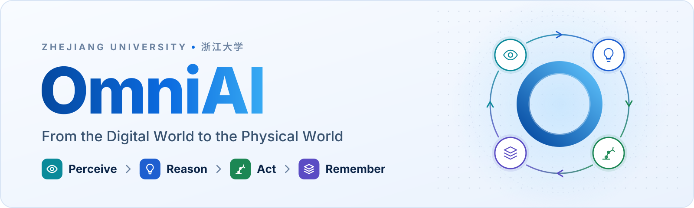
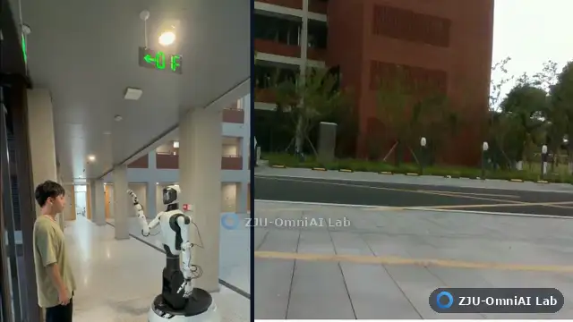
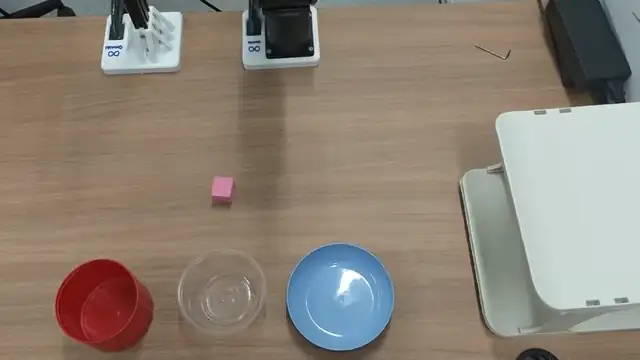
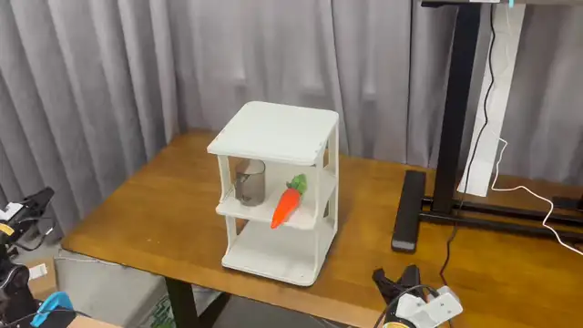
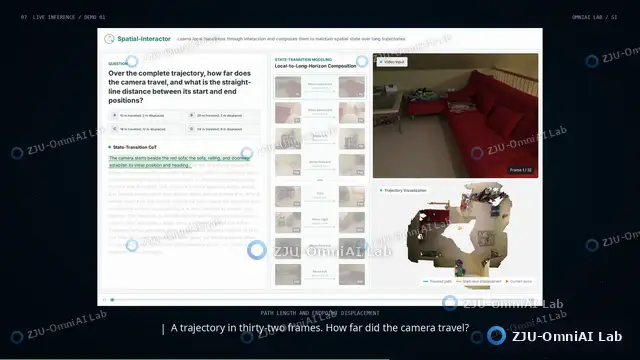
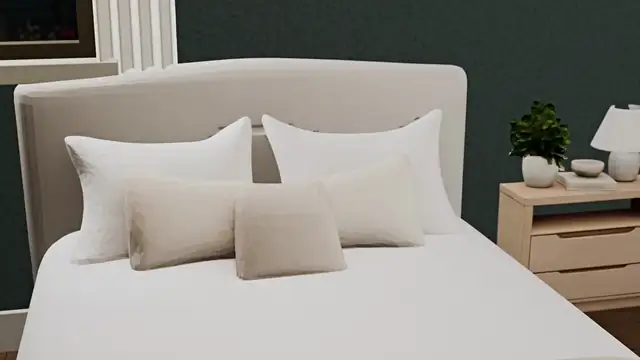
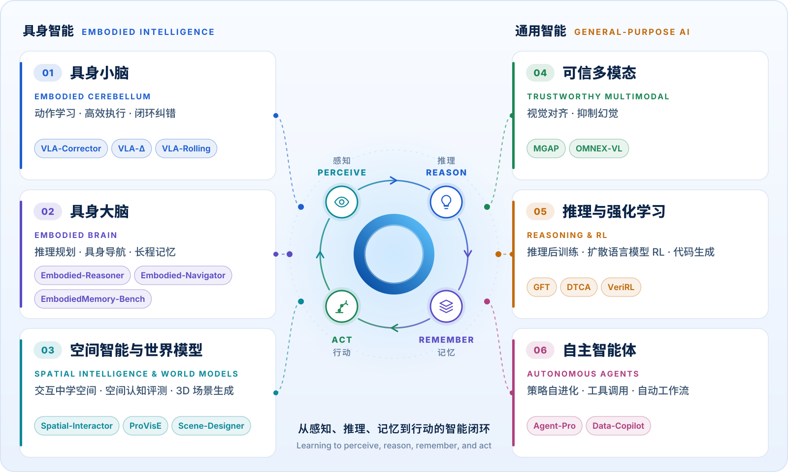
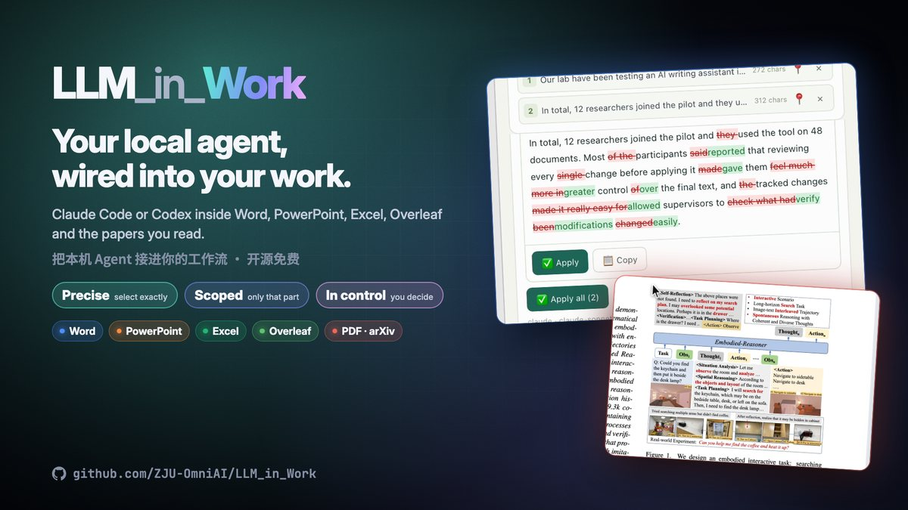
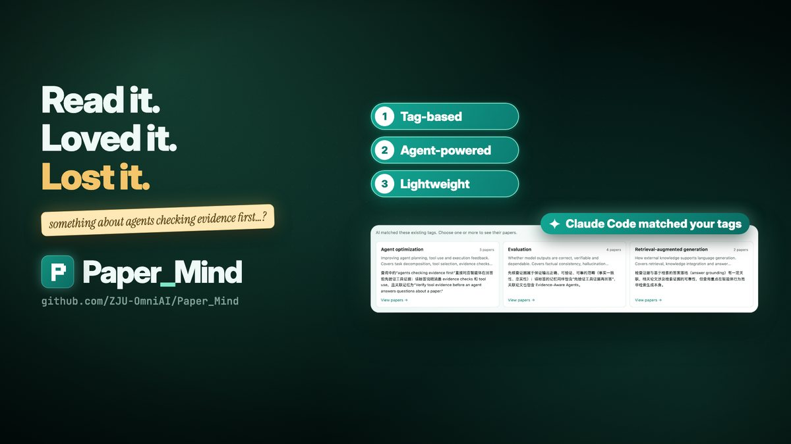

<picture>
  <source media="(prefers-color-scheme: dark)" srcset="assets/banner-dark.svg">
  
</picture>

<picture>
  <source media="(prefers-color-scheme: dark)" srcset="assets/ticker-dark.svg">
  
</picture>

  
  
  
  
   
  
  &nbsp;
  
   
  
  
  

**浙江大学 OmniAI 团队**：从数字世界到物理世界，构建感知、推理、行动、记忆的智能闭环，以**具身小脑与具身大脑**为主线，探索通用智能的学习与实践

<picture>
  <source media="(prefers-color-scheme: dark)" srcset="assets/divider-dark.svg">
  
</picture>

**ZJU-OmniAI** at Zhejiang University builds AI **from the digital world to the physical world**: systems that **perceive**, **reason**, **act**, and **remember** in one closed loop. Our research spans **embodied intelligence**, **spatial cognition**, **trustworthy multimodal models**, **reinforcement learning**, and **autonomous agents**.

  <a href="#news"><b>News</b></a> ·
  <a href="#featured"><b>Featured Projects</b></a> ·
  <a href="#research"><b>Research Map</b></a> ·
  <a href="#tools"><b>Tools</b></a> ·
  <!-- People link hidden for now (uncomment to show): <a href="https://github.com/ZJU-OmniAI/.github/blob/main/people/README.md"><b>People · 团队成员</b></a> · -->
  <a href="https://github.com/orgs/ZJU-OmniAI/repositories"><b>All Repositories</b></a>

## News · 最新动态

- **2026.11** &nbsp;`量子位`&nbsp; [《2B模型拿下98.4%成功率！浙大VLA新成果让机器人学会状态变化》](https://mp.weixin.qq.com/s?__biz=MzIzNjc1NzUzMw==&mid=2247944089&idx=3&sn=921607acca3d33beb525df750c81272b&chksm=e9251f0e49a96bc5bc031302fd92ceb5984e597eb46cebeb469be0107602844b039915dec49e#rd) · [**VLA-Δ**](https://github.com/ZJU-OmniAI/VLA-Delta) · [项目主页](https://zju-omniai.github.io/VLA-Delta/)
- **2026.10** &nbsp;`新智元`&nbsp; [《具身智能体长程记忆：看见不等于记住，浙大提出具身记忆基准》](https://mp.weixin.qq.com/s?__biz=MzI3MTA0MTk1MA==&mid=2652735627&idx=3&sn=2195898b4588173b111e6ffc13732156) · [**EmbodiedMemory-Bench**](https://github.com/ZJU-OmniAI/Embodied-Omni/tree/main/embodied_memory) · [项目主页](https://zju-omniai.github.io/Embodied-Omni/EmbodiedMemoryBench/)
- **2026.10** &nbsp;`青稞 AI`&nbsp; [《让大模型从运动和交互中学习空间推理，理解环境变化。浙大团队最新提出Spatial-Interactor》](https://www.qingkeai.online/blog/Spatial-Interactor) · [**Spatial-Interactor**](https://github.com/ZJU-OmniAI/Spatial-Interactor) · [项目主页](https://zju-omniai.github.io/Spatial-Interactor/)
- **2026.09** &nbsp;`机器之心`&nbsp; [《VLA开环盲区，终于被堵上了：40M Corrector让机器人边做边纠错》](https://mp.weixin.qq.com/s/rfSPbtc2_fRpggXeBPPC3Q) · [**VLA-Corrector**](https://github.com/ZJU-OmniAI/vla-corrector) · [项目主页](https://zju-omniai.github.io/vla-corrector/)
- **2026.08** &nbsp;`新智英`&nbsp; [《浙大&浙江人形提出高效具身导航模型，统一动作、思考、记忆与强化学习！》](https://mp.weixin.qq.com/s?__biz=MzE5MTA0NzYxMQ==&mid=2247517546&idx=1&sn=36f6f48ef7b205cf90921a6a0326cc68&chksm=97edfe09f63dfb5ccf46fd2d1e053538b6eadff657e2bc32af7dc1723ccae29ccc05cb0620eb#rd) · [**Embodied-Navigator**](https://github.com/ZJU-OmniAI/Embodied-Omni/tree/main/embodied_navigator) · [项目主页](https://zju-omniai.github.io/Embodied-Navigator/)
- **2026.08** &nbsp;`机器之心`&nbsp; [《让生成式模型「画」出空间智能，而非强迫LLM输出「坐标」! 浙大提出Agentic空间认知评估框架》](https://www.jiqizhixin.com/articles/2026-08-08-4) · [微信原文](https://mp.weixin.qq.com/s?__biz=MzA3MzI4MjgzMw==&mid=2651049201&idx=3&sn=0d392ccc606293b0469161d091a1d940&chksm=85dcf83ea1bfefa7e91ac9e0132a73729751589a0ef4bfc3e6078a510bda7c0ed3b55d79a251#rd) · [**ProVisE**](https://github.com/ZJU-OmniAI/ProVisE) · [项目主页](https://zju-omniai.github.io/ProVisE/)
- **2026.07** &nbsp;`具身智能之心`&nbsp; [《40M 补上开环盲区！VLA-Corrector 让 VLA 学会发现并纠错（浙大&达摩院）》](https://mp.weixin.qq.com/s?__biz=MzkyMDY0OTc1NA==&mid=2247540637&idx=1&sn=0f177736092e21a930e0d9dc40a2a583) · [**VLA-Corrector**](https://github.com/ZJU-OmniAI/vla-corrector) · [项目主页](https://zju-omniai.github.io/vla-corrector/)

## Featured Projects · 代表项目

Badges show GitHub stars and all-time Hugging Face downloads. Cross-repository totals refresh every 5 minutes; badges are cached and may lag behind the source. <a href="https://github.com/ZJU-OmniAI/.github/tree/main/metrics">Refresh details</a>.

<table>
<tr>
<td width="50%" valign="top">

<b><a href="https://github.com/ZJU-OmniAI/Embodied-Omni">Embodied-Omni</a></b> &nbsp;<code>ACL 2026 Main</code> 
   
Our embodied-brain series in one repository: <b>Embodied-Reasoner</b> plans and reflects, <b>Embodied-Navigator</b> points, thinks, and remembers on the move, and <b>EmbodiedMemory-Bench</b> tests long-horizon memory. 
<a href="https://embodied-reasoner.github.io/">Reasoner</a> · <a href="https://zju-omniai.github.io/Embodied-Navigator/">Navigator</a> · <a href="https://zju-omniai.github.io/Embodied-Omni/EmbodiedMemoryBench/">Memory-Bench</a>
</td>
<td width="50%" valign="top">

<b><a href="https://github.com/ZJU-OmniAI/vla-corrector">VLA-Corrector</a></b> &nbsp;<code>NeurIPS 2026</code> 
 
A lightweight external corrector that watches for visual drift during action chunks, interrupts stale actions, and triggers replanning, so open-loop VLA policies recover instead of failing blindly. 
<a href="https://arxiv.org/abs/2607.01804">Paper</a> · <a href="https://zju-omniai.github.io/vla-corrector/">Project</a>
</td>
</tr>
<tr>
<td width="50%" valign="top">

<b><a href="https://github.com/ZJU-OmniAI/VLA-Delta">VLA-Δ</a></b> &nbsp;<code>arXiv 2026</code> 
  
Don't just imitate actions, understand change: learns physical state transitions for robot control, with 98.4% on LIBERO and 68.0% across five real-robot tasks. 
<a href="https://arxiv.org/abs/2610.21306">Paper</a> · <a href="https://zju-omniai.github.io/VLA-Delta/">Project</a> · <a href="https://huggingface.co/models?search=t0rn0d0/VLA-Delta">🤗 Models</a>
</td>
<td width="50%" valign="top">

<b><a href="https://github.com/ZJU-OmniAI/Spatial-Interactor">Spatial-Interactor</a></b> &nbsp;<code>arXiv 2026</code> 
   
The world responds: learns spatial reasoning from motion and interaction, covering local state transitions and long-horizon reasoning in real and simulated trajectories. 
<a href="https://arxiv.org/abs/2609.23038">Paper</a> · <a href="https://zju-omniai.github.io/Spatial-Interactor/">Project</a> · <a href="https://huggingface.co/datasets/kagakouko/LSI-108K">🤗 LSI-108K</a>
</td>
</tr>
<tr>
<td width="50%" valign="top">

<b><a href="https://github.com/ZJU-OmniAI/Scene-Designer">Scene-Designer</a></b> &nbsp;<code>arXiv 2026</code> 
   
Design intelligence for agentic 3D scene generation: build physically valid, functionally correct scenes, critique them, and refine with Critic-guided Scene-GRPO. 
<a href="https://arxiv.org/abs/2610.23121">Paper</a> · <a href="https://zju-omniai.github.io/Scene-Designer/">Project</a> · <a href="https://huggingface.co/XuanyuLiu/Scene-Builder-Qwen3-VL-8B-Instruct">🤗 Model</a>
</td>
<td width="50%" valign="top">

<b><a href="https://github.com/ZJU-OmniAI/Data-Copilot">Data-Copilot</a></b> &nbsp;<code>ICLR 2024 Workshop · Oral</code> 
 
Connects natural-language requests with heterogeneous data: the agent designs its own interface tools, then plans analysis and visualization workflows on demand. 
<a href="https://arxiv.org/abs/2306.07209">Paper</a> · <a href="https://openreview.net/forum?id=iUEBnQyfWE">OpenReview</a>
</td>
</tr>
</table>

## Research Map · 研究方向

<picture>
  <source media="(prefers-color-scheme: dark)" srcset="assets/research-map-dark.svg">
  
</picture>

### 01 · 具身小脑 · Embodied Cerebellum

Action learning, efficient execution, and closed-loop correction. 让机器人理解动作带来的物理变化，在执行中感知偏差、及时纠错。

<table>
<tr><th align="left" width="27%">Project</th><th align="left">What it does</th></tr>
<tr><td valign="top"><b><a href="https://github.com/ZJU-OmniAI/vla-corrector">VLA-Corrector</a></b> NeurIPS 2026</td><td valign="top">Monitor visual drift during action chunks, interrupt stale actions, and guide corrective replanning with a lightweight external corrector. <a href="https://arxiv.org/abs/2607.01804">Paper</a> · <a href="https://zju-omniai.github.io/vla-corrector/">Project</a> </td></tr>
<tr><td valign="top"><b><a href="https://github.com/ZJU-OmniAI/VLA-Delta">VLA-Δ</a></b> arXiv 2026</td><td valign="top">Learn action-relevant representations from physical state differences, then generate continuous actions with a flow-matching action expert. <a href="https://arxiv.org/abs/2610.21306">Paper</a> · <a href="https://zju-omniai.github.io/VLA-Delta/">Project</a> · <a href="https://huggingface.co/models?search=t0rn0d0/VLA-Delta">🤗&nbsp;Models</a>  </td></tr>
<tr><td valign="top"><b><a href="https://github.com/ZJU-OmniAI/VLA-Rolling">VLA-Rolling</a></b> arXiv 2026</td><td valign="top">Carry the unexecuted action tail into the next planning window; a confidence estimator sets renoising and the denoising budget. <a href="https://arxiv.org/abs/2610.25043">Paper</a> · <a href="https://chenbao123ww.github.io/VLA-Rolling/">Project</a> · <a href="https://huggingface.co/Chenbao77/VLA-Rolling">🤗&nbsp;Model</a>  </td></tr>
</table>

📚 Reading list: **[Awesome Closed-Loop VLA](https://github.com/ZJU-OmniAI/Awesome-Closed-Loop-VLA)**, connecting execution, prediction, and learning loops. 

### 02 · 具身大脑 · Embodied Brain

Reasoning, planning, navigation, and memory for long-horizon interaction. 让智能体理解环境、记住经验、规划任务，并在交互中反思与调整。All three projects live in the **[Embodied-Omni](https://github.com/ZJU-OmniAI/Embodied-Omni)** repository.

<table>
<tr><th align="left" width="27%">Project</th><th align="left">What it does</th></tr>
<tr><td valign="top"><b><a href="https://github.com/ZJU-OmniAI/Embodied-Omni/tree/main/embodied_reasoner">Embodied-Reasoner</a></b> ACL 2026 Main</td><td valign="top">Combine visual search, long-horizon planning, environment-state reasoning, and reflection in an observation–thought–action loop. <a href="https://aclanthology.org/2026.acl-long.1910/">Paper</a> · <a href="https://embodied-reasoner.github.io/">Project</a> · <a href="https://huggingface.co/datasets/zwq2018/embodied_reasoner">🤗&nbsp;Data</a>  </td></tr>
<tr><td valign="top"><b><a href="https://github.com/ZJU-OmniAI/Embodied-Omni/tree/main/embodied_navigator">Embodied-Navigator</a></b> arXiv 2026</td><td valign="top">Connect pixel pointing to 3D navigation with selective reasoning, Anchor-Trajectory Memory, and Two-Level GRPO. <a href="https://arxiv.org/abs/2608.17512">Paper</a> · <a href="https://zju-omniai.github.io/Embodied-Navigator/">Project</a> · <a href="https://huggingface.co/UnderTides/Embodied-Navigator-7B-GRPO">🤗&nbsp;Model</a>  </td></tr>
<tr><td valign="top"><b><a href="https://github.com/ZJU-OmniAI/Embodied-Omni/tree/main/embodied_memory">EmbodiedMemory-Bench</a></b> arXiv 2026</td><td valign="top">Evaluate retained observations, changing world states, interaction-derived knowledge, and experience generalization. <a href="https://arxiv.org/abs/2609.28236">Paper</a> · <a href="https://zju-omniai.github.io/Embodied-Omni/EmbodiedMemoryBench/">Project</a> · <a href="https://huggingface.co/datasets/lzLiang/EmbodiedMemoryBench">🤗&nbsp;Data</a>  </td></tr>
</table>

### 03 · 空间智能与世界模型 · Spatial Intelligence & World Models

Learning and evaluating how AI understands and constructs the physical world. 从交互中学习空间关系与状态变化，建立可检验的空间认知，并让智能体设计物理合理、功能正确的 3D 场景。

<table>
<tr><th align="left" width="27%">Project</th><th align="left">What it does</th></tr>
<tr><td valign="top"><b><a href="https://github.com/ZJU-OmniAI/Spatial-Interactor">Spatial-Interactor</a></b> arXiv 2026</td><td valign="top">Learn local state transitions and long-horizon spatial reasoning from real and simulated interaction trajectories. <a href="https://arxiv.org/abs/2609.23038">Paper</a> · <a href="https://zju-omniai.github.io/Spatial-Interactor/">Project</a> · <a href="https://huggingface.co/models?search=kagakouko/Spatial-Interactor">🤗&nbsp;Models</a> · <a href="https://huggingface.co/datasets/kagakouko/LSI-108K">🤗&nbsp;Data</a>   </td></tr>
<tr><td valign="top"><b><a href="https://github.com/ZJU-OmniAI/ProVisE">ProVisE</a></b> arXiv 2026</td><td valign="top">Evaluate spatial cognition through protocol-constrained visual answers, sharing task semantics and metrics across model families. <a href="https://arxiv.org/abs/2607.21072">Paper</a> · <a href="https://zju-omniai.github.io/ProVisE/">Project</a> · <a href="https://huggingface.co/datasets/wx91726/SpatialGen-Bench">🤗&nbsp;Data</a>  </td></tr>
<tr><td valign="top"><b><a href="https://github.com/ZJU-OmniAI/Scene-Designer">Scene-Designer</a></b> arXiv 2026</td><td valign="top">Build physically valid, functionally correct, layout-coherent 3D scenes, critique their quality, and refine design decisions with Critic-guided Scene-GRPO. <a href="https://arxiv.org/abs/2610.23121">Paper</a> · <a href="https://zju-omniai.github.io/Scene-Designer/">Project</a> · <a href="https://huggingface.co/XuanyuLiu/Scene-Builder-Qwen3-VL-8B-Instruct">🤗&nbsp;Model</a> · <a href="https://huggingface.co/datasets/XuanyuLiu/Scene-OTC-Bench">🤗&nbsp;Data</a>   </td></tr>
</table>

📚 Reading list: **[Awesome World Model](https://github.com/ZJU-OmniAI/Awesome-World-Model)**, with papers, frameworks, datasets, and benchmarks for world-model research. 

### 04 · 可信多模态 · Trustworthy Multimodal Intelligence

Better visual grounding and more reliable multimodal understanding. 减少多模态幻觉，让模型的判断更忠实于视觉证据。

<table>
<tr><th align="left" width="27%">Project</th><th align="left">What it does</th></tr>
<tr><td valign="top"><b><a href="https://github.com/ZJU-OmniAI/MGAP">MGAP</a></b> ICML 2026</td><td valign="top">Reduce object hallucinations with geometry-aware, training-free adaptive projection while preserving semantic structure. <a href="https://arxiv.org/abs/2606.09859">Paper</a> · <a href="https://openreview.net/forum?id=LInDSHWGMK">OpenReview</a> </td></tr>
<tr><td valign="top"><b><a href="https://github.com/ZJU-OmniAI/OMNEX-VL">OMNEX-VL</a></b> AAAI 2026</td><td valign="top">Improve visual grounding through caption feedback, diversity-aware sampling, and conflict regularization. <a href="https://ojs.aaai.org/index.php/AAAI/article/view/37772">Paper</a> · <a href="https://huggingface.co/OmniAI-ZJU/OMNEX-VL">🤗&nbsp;Model</a> · <a href="https://huggingface.co/datasets/OmniAI-ZJU/OMNEX-VL-DATA">🤗&nbsp;Data</a>   </td></tr>
</table>

### 05 · 推理与强化学习 · Reasoning & Reinforcement Learning

Post-training methods for reasoning and verifiable generation. 研究从模仿学习到奖励优化的衔接，覆盖自回归与扩散语言模型，提升推理、代码生成与学习效率。

<table>
<tr><th align="left" width="27%">Project</th><th align="left">What it does</th></tr>
<tr><td valign="top"><b><a href="https://github.com/ZJU-OmniAI/GFT">GFT</a></b> ACL 2026 Findings</td><td valign="top">Bridge imitation and reward fine-tuning with unbiased group advantages and dynamic coefficient rectification. <a href="https://aclanthology.org/2026.findings-acl.1444/">Paper</a> · <a href="https://huggingface.co/datasets/OmniAI-ZJU/NuminaMath-Cot-Distillation-100K">🤗&nbsp;Data</a>  </td></tr>
<tr><td valign="top"><b><a href="https://github.com/ZJU-OmniAI/DTCA">DTCA</a></b> arXiv 2026</td><td valign="top">Assign token-level credit in RL for diffusion language models through contribution-weighted denoising-step selection, part-of-speech credit, and entropy-flow calibration. <a href="https://arxiv.org/abs/2610.35201">Paper</a> · <a href="https://zju-omniai.github.io/DTCA/">Project</a> </td></tr>
<tr><td valign="top"><b><a href="https://github.com/ZJU-OmniAI/VeriRL">VeriRL</a></b> arXiv 2025</td><td valign="top">Improve Verilog generation through reinforcement learning with trace-back reward rescoring and sample-balanced optimization. <a href="https://arxiv.org/abs/2508.18462">Paper</a> · <a href="https://huggingface.co/tttboy/Verirl-CodeQwen2.5">🤗&nbsp;Model</a> · <a href="https://huggingface.co/datasets/tttboy/Veribench-53K">🤗&nbsp;Data</a>   </td></tr>
</table>

### 06 · 自主智能体 · Autonomous Agents & Tool Use

Agents that improve their policies and turn instructions into workflows. 从策略反思与优化，到数据分析、工具调用和自主工作流。

<table>
<tr><th align="left" width="27%">Project</th><th align="left">What it does</th></tr>
<tr><td valign="top"><b><a href="https://github.com/ZJU-OmniAI/Agent-Pro">Agent-Pro</a></b> ACL 2024</td><td valign="top">Enable LLM agents to evolve their decision policies through policy-level reflection and optimization. <a href="https://aclanthology.org/2024.acl-long.292/">Paper</a> </td></tr>
<tr><td valign="top"><b><a href="https://github.com/ZJU-OmniAI/Data-Copilot">Data-Copilot</a></b> ICLR 2024 Workshop · Oral</td><td valign="top">Connect natural-language requests with heterogeneous data through autonomous tool design, analysis, and visualization workflows. <a href="https://arxiv.org/abs/2306.07209">Paper</a> · <a href="https://openreview.net/forum?id=iUEBnQyfWE">OpenReview</a> </td></tr>
</table>

## Tools for Research & Work · 科研工具

<table>
<tr>
<td width="50%" valign="top">

<b><a href="https://github.com/ZJU-OmniAI/LLM_in_Work">LLM_in_Work</a></b> 
 
Your local Claude Code or Codex agent in Word, PowerPoint, Excel, Overleaf, and the PDFs you read in Chrome: select exactly what you mean, review the diff, and edit only that part, or just ask.
</td>
<td width="50%" valign="top">

<b><a href="https://github.com/ZJU-OmniAI/Paper_Mind">Paper_Mind</a></b> 
 
A tag-based library for the papers you collect: one-click capture, tags and topic packs, local and LLM search, and recommendations from your own collection.
</td>
</tr>
</table>

<picture>
  <source media="(prefers-color-scheme: dark)" srcset="assets/divider-dark.svg">
  
</picture>

 
Find our work useful? A ⭐ on the repository helps others discover it. 
如果我们的工作对你有帮助，欢迎点个 ⭐
  
<a href="https://github.com/orgs/ZJU-OmniAI/repositories"><picture><source media="(prefers-color-scheme: dark)" srcset="assets/links/repos-dark.svg"></picture></a>&nbsp;
<a href="https://huggingface.co/OmniAI-ZJU"><picture><source media="(prefers-color-scheme: dark)" srcset="assets/links/huggingface-dark.svg"></picture></a>&nbsp;
<a href="#news"><picture><source media="(prefers-color-scheme: dark)" srcset="assets/links/news-dark.svg"></picture></a>&nbsp;
<!-- People link hidden for now (uncomment to show): <a href="https://github.com/ZJU-OmniAI/.github/blob/main/people/README.md"><picture><source media="(prefers-color-scheme: dark)" srcset="assets/links/people-dark.svg"></picture></a>&nbsp; -->
<a href="mailto:zhangwenqi@zju.edu.cn"><picture><source media="(prefers-color-scheme: dark)" srcset="assets/links/contact-dark.svg"></picture></a>

